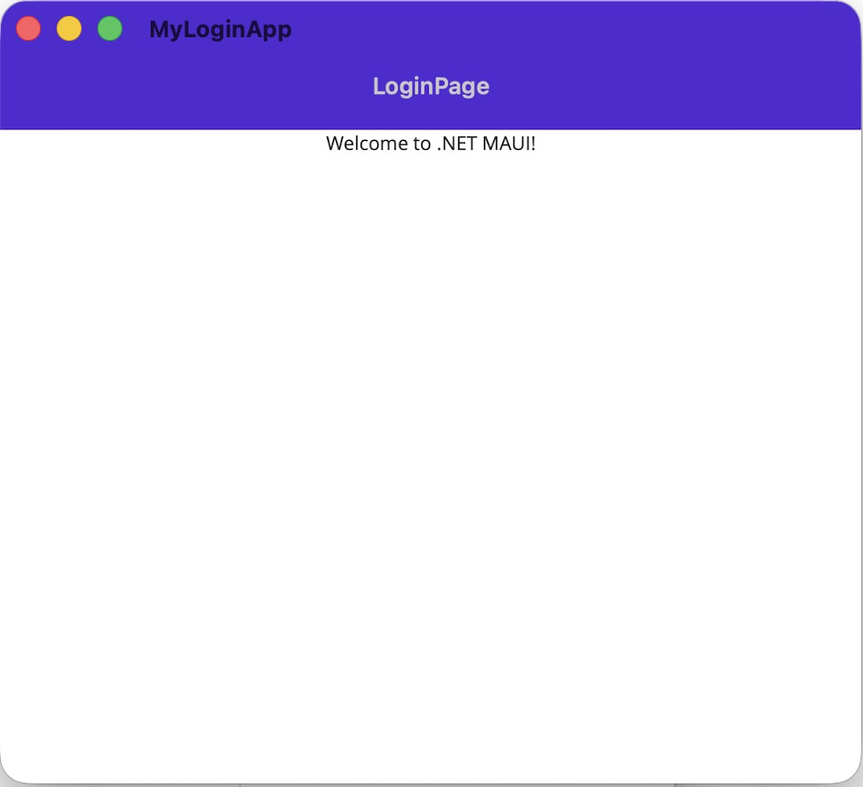

# MyLoginApp

A cross-platform login application built with .NET MAUI.

## Features

- .NET MAUI single-project structure
- Login screen with email and password fields
- Basic login validation
- Runs on Android, iOS, macOS, and Windows

## Screenshots

### Login Screen



## Getting Started

### Prerequisites

- .NET SDK
- Visual Studio
- .NET MAUI workload installed

### Run the Application

1. Clone the repository

```bash
git clone https://github.com/GarbyX/MyLoginApp.git
```

2. Open the solution in Visual Studio.

3. Build and run the project.

## Project Structure

```text
MyLoginApp
├── App.xaml
├── AppShell.xaml
├── MainPage.xaml
├── LoginPage.xaml
├── Platforms/
└── Resources/
```

## Technologies Used

- C#
- XAML
- .NET MAUI

## Future Improvements

- API authentication
- Registration page
- Forgot password feature
- Secure credential storage
- MVVM architecture

## Author

Gabriel Madichie

GitHub: https://github.com/garbyx
